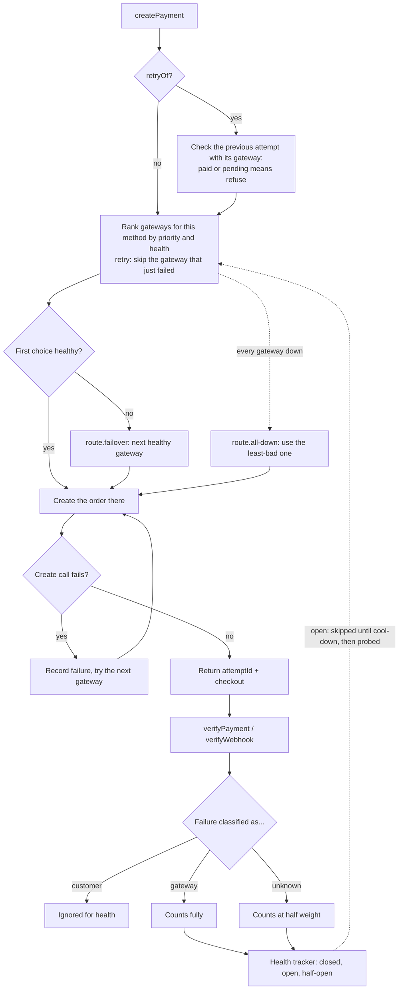

# gateway-guard

[](https://github.com/pithavanihar/gateway-guard/actions/workflows/ci.yml)
[](https://www.npmjs.com/package/gateway-guard)
[](LICENSE)

**Send each Indian payment to a gateway that is working right now.** A zero-dependency TypeScript library for Razorpay and Cashfree.

When a gateway or a bank starts failing, most apps keep sending customers to it, or they treat every failed payment the same way. gateway-guard sorts failures by whose fault they are, tracks which gateway and payment method are actually unhealthy, and moves new payments (and retries) to a gateway that works, without ever creating a second live payment for the same order.

## The three rules

1. **Customer failures don't count.** A cancelled payment, a closed page or a wrong OTP says nothing about a gateway's health, and is never held against it. Only gateway-side failures (bank or network errors, timeouts, server errors) count. Ambiguous ones count at half weight.
2. **Health is tracked per gateway and per payment method.** Razorpay netbanking can be down while Razorpay UPI is fine, so the unit of health is the pair `(gateway, method)`.
3. **A retry goes to a different gateway.** If a customer's payment fails on gateway A and they retry, the retry is routed to another gateway, even when A still looks healthy. If no other gateway is usable it falls back to A.

## How routing works



Each `(gateway, method)` pair has a circuit breaker. When the failure rate in the recent window crosses a threshold the pair opens and new payments skip it. After a cool-down a small share of payments is let through as a probe: successes close the circuit, a failure re-opens it. If every gateway is down for a method, the least-bad one is used and `route.all-down` is emitted, rather than refusing to take payment.

## Quick start

```bash
npm install gateway-guard
```

Node.js 18 or newer. No runtime dependencies (uses the built-in `fetch`). ESM and CommonJS builds, with types.

```ts
import { GatewayGuard } from "gateway-guard";

const guard = new GatewayGuard({
  gateways: {
    razorpay: {
      keyId: process.env.RAZORPAY_KEY_ID!,
      keySecret: process.env.RAZORPAY_KEY_SECRET!,
      webhookSecret: process.env.RAZORPAY_WEBHOOK_SECRET!,
    },
    cashfree: {
      appId: process.env.CASHFREE_APP_ID!,
      secretKey: process.env.CASHFREE_SECRET_KEY!, // also signs Cashfree webhooks
      env: "sandbox", // or "production"
    },
  },
  priority: ["razorpay", "cashfree"], // preferred order when everything is healthy
});

// 1. Create a payment. Amounts are in paise.
const { attemptId, gateway, checkout } = await guard.createPayment({
  orderId: "order-1001", // your id, at most 40 characters
  amountMinor: 49900, // Rs 499
  currency: "INR",
  method: "netbanking", // "upi" | "card" | "netbanking"
  customer: { id: "cust-1", phone: "9999999999", email: "a@example.com" },
});
// Send `checkout` to the browser. It tells the frontend which gateway SDK to open and with what.

// 2a. The customer closed the checkout without paying: reopen the same one.
const again = guard.resume(attemptId); // same { attemptId, gateway, checkout }, no gateway call

// 2b. A payment failed and the customer retries: pass the failed attemptId.
const retry = await guard.createPayment({ /* same fields */ retryOf: attemptId });
// retry.gateway is a different gateway whenever another one is usable.

// 3. After the checkout returns, verify on the server. This also feeds the health tracker.
const outcome = await guard.verifyPayment(attemptId, payloadFromBrowser);
// { status: "paid" | "failed" | "pending", classification?, reason?, method? }
```

The webhook route is yours, because this is a library and not a server. **Pass the raw request body**, not a parsed-and-reserialised one: signatures are computed over the exact bytes the gateway sent.

```ts
app.post("/webhooks/:gateway", express.raw({ type: "*/*" }), (req, res) => {
  try {
    guard.verifyWebhook(req.params.gateway as "razorpay" | "cashfree", req.body, req.headers);
    res.sendStatus(200);
  } catch (err) {
    if (err instanceof InvalidSignatureError) return void res.sendStatus(400);
    throw err;
  }
});
```

Passing a parsed object (for example from `express.json()`) throws `ValidationError("pass the raw request body")`.

### Webhooks to enable

Point each gateway's webhook at your route and subscribe to these events:

| Gateway  | Events                                                                              | Webhook secret                                        |
| -------- | ----------------------------------------------------------------------------------- | ----------------------------------------------------- |
| Razorpay | `payment.captured`, `payment.failed`                                                | the `webhookSecret` you set in the Razorpay dashboard |
| Cashfree | `PAYMENT_SUCCESS_WEBHOOK`, `PAYMENT_FAILED_WEBHOOK`, `PAYMENT_USER_DROPPED_WEBHOOK` | your Cashfree `secretKey` (Cashfree signs with it)    |

Other events are verified and returned with `status: "other"` and do not change health or attempts. That includes Razorpay's `order.paid`: enable `payment.captured` for payment confirmation.

Full runnable versions: [`examples/server-express.ts`](examples/server-express.ts) (create, resume, verify and webhook routes) and [`examples/browser-checkout.html`](examples/browser-checkout.html) (launching Razorpay Checkout.js or Cashfree's JS SDK from the `checkout` object, reopening a closed checkout and retrying a failed one).

`checkout` is a small tagged object:

| `checkout.gateway` | Fields                                                           | Frontend                                          |
| ------------------ | ---------------------------------------------------------------- | ------------------------------------------------- |
| `razorpay`         | `keyId`, `orderId`, `amountMinor`, `currency`, `method`          | Razorpay Checkout.js                              |
| `cashfree`         | `paymentSessionId`, `mode` (`sandbox` or `production`), `method` | Cashfree JS SDK (`Cashfree({ mode }).checkout()`) |

Card details are collected by the gateways' own checkout. gateway-guard never sees or stores them.

## Retry rules

A retry is `createPayment({ ..., retryOf: previousAttemptId })`. To make double charges hard, it is refused with a `RetryNotAllowedError` (check `err.reason`) when:

| `reason`          | Meaning                                                                                                                                  |
| ----------------- | ---------------------------------------------------------------------------------------------------------------------------------------- |
| `paid`            | The order has already been paid.                                                                                                         |
| `pending`         | The previous attempt is still pending at its gateway (a payment was started and has no final result yet).                                |
| `status-unknown`  | The previous attempt's status could not be confirmed, or its order could not be stopped.                                                 |
| `unknown-attempt` | `retryOf` is not an attempt this instance knows (wrong id, expired, or the process restarted).                                           |
| `superseded`      | `retryOf` is not the latest attempt of its order, **or** you called `createPayment` without `retryOf` for an order that already has one. |
| `in-progress`     | Another `createPayment` for the same `orderId` is still running.                                                                         |

- A retry goes to **another gateway**, and only the **latest** attempt of an order can be retried.
- Before routing a retry, the previous attempt's status is fetched from its gateway. A retry is allowed when that attempt **failed**, or when its checkout was **opened and closed without any payment** (status `created`). A failed or paid status found here is recorded exactly as a callback or webhook would be (once per attempt), so failures you never verified still reach health.
- **Cashfree orders are terminated** before a retry is created, so the old session can no longer be paid. If it cannot be terminated, the retry is refused (`status-unknown`).
- Razorpay orders cannot be cancelled. See [Safety and limits](#safety-and-limits).

### Reopening a closed checkout: `resume()`

When the customer closes the checkout without paying, prefer `guard.resume(attemptId)` over a retry: it returns the same `{ attemptId, gateway, checkout }` for the browser to reopen, without creating another gateway order and without a gateway call. It is refused with a `RetryNotAllowedError`:

| `reason`          | Meaning                                                                                                        |
| ----------------- | -------------------------------------------------------------------------------------------------------------- |
| `unknown-attempt` | The attempt is unknown or has expired (expired attempts are forgotten, so the two look the same).              |
| `paid`            | The attempt, or another attempt of its order, is confirmed paid.                                               |
| `in-progress`     | A `createPayment` for the same `orderId` is running.                                                           |
| `superseded`      | The attempt was retried, its gateway order was cancelled for a retry, or it has already failed. Retry instead. |

The example browser page calls `resume` when the checkout is dismissed and falls back to a retry (`retryOf`) when resume is refused for any reason other than `paid`.

Input limits worth knowing: `orderId` is at most 40 characters; `amountMinor` is a positive integer of paise and at least 100 (Rs 1) on both gateways; `customer.phone` is required for every gateway. For Cashfree, `customer.phone` must be 10 digits or `+` followed by an international number, and `customer.id` is normalised to Cashfree's rules (non-alphanumerics dropped, padded to 3 characters, cut to 50). Invalid input throws `ValidationError` before any request is sent, so it never affects health.

## What counts against a gateway

These tables are **generated from the rule data the library ships** (`classify.ts` in each adapter), so they cannot drift from the code. Regenerate them with `npm run docs:tables`; the test suite fails if they are stale.

<!-- BEGIN GENERATED TABLES (npm run docs:tables) -->

#### Razorpay

Lookup order: reason table, then `error_source`, then error `code`, then `unknown`.

| Reason                                  | Counts as | Meaning                                            |
| --------------------------------------- | --------- | -------------------------------------------------- |
| `payment_cancelled`                     | customer  | Customer cancelled the payment                     |
| `payment_session_expired`               | customer  | Payment session expired before completion          |
| `payment_collect_request_expired`       | customer  | Customer did not approve the UPI collect request   |
| `collect_request_pending`               | customer  | A collect request is already awaiting the customer |
| `incorrect_otp`                         | customer  | Wrong OTP entered                                  |
| `otp_expired`                           | customer  | OTP expired                                        |
| `otp_attempts_exceeded`                 | customer  | Too many OTP attempts                              |
| `incorrect_pin`                         | customer  | Wrong PIN entered                                  |
| `incorrect_atm_pin`                     | customer  | Wrong ATM PIN entered                              |
| `pin_attempts_exceeded`                 | customer  | Too many PIN attempts                              |
| `pin_not_set`                           | customer  | No PIN set for the payment method                  |
| `incorrect_cvv`                         | customer  | Wrong CVV entered                                  |
| `incorrect_card_details`                | customer  | Wrong card details entered                         |
| `incorrect_card_expiry_date`            | customer  | Wrong card expiry date entered                     |
| `incorrect_cardholder_name`             | customer  | Wrong cardholder name entered                      |
| `card_number_invalid`                   | customer  | Card number is invalid                             |
| `invalid_vpa`                           | customer  | Wrong UPI VPA entered                              |
| `insufficient_funds`                    | customer  | Not enough funds in the account                    |
| `card_declined`                         | customer  | Card declined by the issuer                        |
| `card_expired`                          | customer  | Card has expired                                   |
| `card_not_enrolled`                     | customer  | Card not enrolled for this payment method          |
| `debit_declined`                        | customer  | Debit declined                                     |
| `debit_instrument_blocked`              | customer  | Card or account blocked by issuer or holder        |
| `debit_instrument_inactive`             | customer  | Card or account inactive                           |
| `international_transaction_not_allowed` | customer  | Card not enabled for international use             |
| `transaction_limit_exceeded`            | customer  | Card credit/debit limit exceeded                   |
| `transaction_daily_limit_exceeded`      | customer  | Daily transaction limit reached                    |
| `transaction_daily_count_exceeded`      | customer  | Daily transaction count reached                    |
| `transaction_frequency_limit_exceeded`  | customer  | NPCI frequency limit reached                       |
| `transaction_on_vpa_restricted`         | customer  | VPA blocked by the customer's PSP                  |
| `funds_blocked_by_mandate`              | customer  | Funds held by an existing mandate                  |
| `authorisation_declined_by_psp`         | customer  | Customer's UPI app rejected the request            |
| `user_not_eligible`                     | customer  | Customer not eligible for credit                   |
| `user_not_registered_for_netbanking`    | customer  | Account not registered for netbanking              |
| `credit_limit_exceeded`                 | customer  | Customer's credit limit exceeded                   |
| `credit_limit_expired`                  | customer  | Customer's credit limit expired                    |
| `credit_limit_inactive`                 | customer  | Customer's credit limit inactive                   |
| `credit_limit_not_approved`             | customer  | Customer's credit limit not approved               |
| `bank_technical_error`                  | gateway   | Technical error at the bank                        |
| `gateway_technical_error`               | gateway   | Technical error at the gateway                     |
| `server_error`                          | gateway   | Internal error at Razorpay                         |
| `issuer_technical_error`                | gateway   | Technical error at the card issuer                 |
| `invalid_response_from_gateway`         | gateway   | Gateway returned an invalid response               |
| `bank_not_available`                    | gateway   | Bank is down                                       |
| `bank_cutoff_in_progress`               | gateway   | Bank's periodic cutoff in progress                 |
| `payment_declined_due_to_high_traffic`  | gateway   | Gateway overloaded                                 |
| `request_timed_out`                     | gateway   | Request to the gateway timed out                   |
| `input_validation_failed`               | unknown   | Request failed validation                          |
| `invalid_request`                       | unknown   | Malformed request                                  |
| `payment_method_not_enabled`            | unknown   | Method not enabled for the merchant                |
| `bank_not_enabled`                      | unknown   | Bank not enabled for the merchant                  |
| `card_network_not_enabled`              | unknown   | Card network not enabled for the merchant          |
| `merchant_not_activated`                | unknown   | Merchant account not activated                     |
| `live_mode_not_enabled`                 | unknown   | Live mode not enabled                              |
| `order_amount_mismatch`                 | unknown   | Order and payment amounts differ                   |
| `order_payment_method_mismatch`         | unknown   | Order and payment methods differ                   |
| `order_already_paid`                    | unknown   | Order already has a successful payment             |
| `payment_risk_check_failed`             | unknown   | Declined by a risk check                           |

Reasons decided by `error_source` alone (Razorpay reports them for customer and provider failures; a missing or unlisted source gives `unknown`):

| Reason                  | Meaning                                                                     |
| ----------------------- | --------------------------------------------------------------------------- |
| `payment_timed_out`     | Not completed in time: customer abandoned, or no response from bank/gateway |
| `authentication_failed` | 3DS/OTP authentication failed: customer abandoned, or issuer/ACS failure    |

Fallback by `error_source` for reasons not listed above:

| Error source       | Counts as |
| ------------------ | --------- |
| `customer`         | customer  |
| `bank`             | gateway   |
| `issuer_bank`      | gateway   |
| `issuer`           | gateway   |
| `beneficiary_bank` | gateway   |
| `gateway`          | gateway   |
| `network`          | gateway   |
| `internal`         | gateway   |
| `razorpay`         | gateway   |

Last-resort fallback by error `code`:

| Error code      | Counts as |
| --------------- | --------- |
| `SERVER_ERROR`  | gateway   |
| `GATEWAY_ERROR` | gateway   |

#### Cashfree

Lookup order: payment status (`USER_DROPPED`, `CANCELLED` are always `customer`), then the reason table, then `error_source`, then `unknown`.

| Reason                            | Counts as | Meaning                                                 |
| --------------------------------- | --------- | ------------------------------------------------------- |
| `user_dropped`                    | customer  | Customer abandoned the flow                             |
| `user_cancelled`                  | customer  | Customer cancelled the payment                          |
| `customer_cancelled`              | customer  | Customer cancelled the payment                          |
| `customer_inactive`               | customer  | Customer did not attempt the payment                    |
| `user_decline`                    | customer  | Customer declined the request                           |
| `request_expired`                 | customer  | Customer did not authorise in time                      |
| `auth_timeout`                    | customer  | Customer did not authenticate in time                   |
| `transaction_time_limit`          | customer  | Payment session expired                                 |
| `invalid_otp`                     | customer  | Wrong OTP entered                                       |
| `invalid_pin`                     | customer  | Wrong PIN entered                                       |
| `invalid_mpin`                    | customer  | Wrong UPI PIN entered                                   |
| `invalid_atmpin`                  | customer  | Wrong ATM PIN entered                                   |
| `invalid_cvv`                     | customer  | Wrong CVV entered                                       |
| `invalid_card_cvv`                | customer  | Wrong CVV entered                                       |
| `invalid_card_number`             | customer  | Wrong card number entered                               |
| `invalid_cardnumber`              | customer  | Wrong card number entered                               |
| `invalid_expiry_date`             | customer  | Wrong card expiry date entered                          |
| `invalid_card_expiry`             | customer  | Wrong card expiry date entered                          |
| `invalid_card_holder_name`        | customer  | Wrong cardholder name entered                           |
| `invalid_vpa`                     | customer  | Wrong UPI ID entered                                    |
| `expired_vpa`                     | customer  | UPI ID has expired                                      |
| `invalid_account_number`          | customer  | Wrong account number entered                            |
| `pin_try_exceeded`                | customer  | Too many PIN attempts                                   |
| `transaction_pin_limit`           | customer  | Too many PIN attempts                                   |
| `insufficient_funds`              | customer  | Not enough funds in the account                         |
| `auth_declined`                   | customer  | Issuer or PSP declined the customer's authorisation     |
| `expired_card`                    | customer  | Card has expired                                        |
| `card_expired`                    | customer  | Card has expired                                        |
| `inactive_card`                   | customer  | Card is inactive                                        |
| `restricted_card`                 | customer  | Card is restricted                                      |
| `lost_card`                       | customer  | Card reported lost                                      |
| `account_blocked`                 | customer  | Account is blocked                                      |
| `account_closed`                  | customer  | Account is closed                                       |
| `inactive_account`                | customer  | Account is closed or inactive                           |
| `credit_limit`                    | customer  | Card credit limit exceeded                              |
| `daily_limit_exceed`              | customer  | Daily transaction limit reached                         |
| `daily_amount_limit`              | customer  | Daily amount limit reached                              |
| `transaction_count_limit`         | customer  | Transaction count limit reached                         |
| `transaction_frequency_limit`     | customer  | Transaction frequency limit reached                     |
| `transaction_limit_exceed`        | customer  | Per-transaction limit set by the remitter bank exceeded |
| `psp_declined`                    | customer  | Customer's UPI app declined the payment                 |
| `psp_unavailable`                 | customer  | Customer's UPI app is unavailable                       |
| `merchant_blocked`                | customer  | Customer has blocked this merchant                      |
| `technical_error`                 | gateway   | Technical error at the bank or gateway                  |
| `general_failure`                 | gateway   | Unspecified bank failure                                |
| `system_error`                    | gateway   | System error at the bank                                |
| `server_error`                    | gateway   | Bank server error                                       |
| `network_error`                   | gateway   | Network error                                           |
| `network_timeout`                 | gateway   | Network timed out                                       |
| `host_timeout`                    | gateway   | Payment processor timed out                             |
| `issuer_timeout`                  | gateway   | Issuer bank timed out                                   |
| `bank_offline`                    | gateway   | Bank is offline                                         |
| `issuer_bank_offline`             | gateway   | Issuer bank is offline                                  |
| `acquirer_bank_offline`           | gateway   | Acquirer bank is offline                                |
| `bank_server_downtime`            | gateway   | Bank or PSP server down                                 |
| `service_provider_down`           | gateway   | Bank's service provider is down                         |
| `response_awaited`                | gateway   | No final response from the bank                         |
| `transaction_timeout`             | gateway   | Gateway processing timed out                            |
| `bank_decline_throttle`           | gateway   | Bank throttled the request                              |
| `cutoff_time`                     | gateway   | Bank cutoff in progress                                 |
| `unknown_network_error`           | gateway   | Unspecified network error                               |
| `merchant_transaction_limit`      | unknown   | Amount exceeds the merchant's limit                     |
| `maximum_amount_limit`            | unknown   | Amount exceeds the merchant's limit                     |
| `currency_not_supported`          | unknown   | Currency not supported for the merchant                 |
| `permission_denied`               | unknown   | PSP not allowed to initiate this payment                |
| `payment_instrument_not_register` | unknown   | Merchant instrument not registered at the bank          |

Reasons decided by `error_source` alone (Cashfree reports them with conflicting sources):

| Reason                     | Meaning                                  |
| -------------------------- | ---------------------------------------- |
| `auth_failure`             | Authentication failed (customer or bank) |
| `debit_failed`             | Debit failed (bank or merchant)          |
| `vpa_resolution_failed`    | UPI ID could not be resolved             |
| `transaction_amount_limit` | Amount limit exceeded                    |
| `transaction_not_allowed`  | Transaction not allowed                  |
| `minimum_amount_limit`     | Amount below the minimum                 |
| `invalid_amount`           | Invalid amount or currency               |
| `fraud_detected`           | Suspected fraud                          |
| `bad_request`              | Malformed request                        |
| `invalid_account`          | Invalid account details                  |
| `limit_exceed`             | Limit exceeded                           |

Fallback by `error_source` for reasons not listed above:

| Error source | Counts as |
| ------------ | --------- |
| `customer`   | customer  |
| `bank`       | gateway   |
| `cashfree`   | gateway   |
| `gateway`    | gateway   |
| `merchant`   | unknown   |

<!-- END GENERATED TABLES -->

- `customer`: the customer's doing. Never counts against health, and switching gateways would not help.
- `gateway`: a technical failure at the gateway, bank or network. Counts fully.
- `unknown`: merchant configuration problems or ambiguous causes. Counts at half weight (`unknownWeight`).

## Configuration

```ts
new GatewayGuard({
  gateways: { razorpay: {/* ... */}, cashfree: {/* ... */} },
  priority: ["razorpay", "cashfree"],
  health: {
    windowSize: 20, // outcomes kept per (gateway, method)
    windowMs: 300_000, // ...and no older than 5 minutes
    minAttempts: 5, // counted outcomes needed before a pair can open
    failureThreshold: 0.5, // weighted failure rate at or above this opens the circuit
    degradedThreshold: 0.25, // at or above this the pair is reported "degraded"
    cooldownMs: 60_000, // open for this long, then half-open
    probeRatio: 0.2, // share of payments let through as probes while half-open
    unknownWeight: 0.5, // weight of an "unknown" failure
  },
  timeoutMs: 15_000, // per gateway request
  onListenerError: (error, event) => {}, // see Events
});
```

`priority` must list every configured gateway exactly once, and nothing else (PhonePe has no built-in adapter in v1); otherwise the constructor throws `ValidationError`. Every `health` field is optional; the values above are the defaults. `guard.health()` returns a snapshot of every `(gateway, method)` pair (`state`, `label`, `failureRate`, `countedAttempts`) for dashboards.

## Events

```ts
const off = guard.on("route.failover", (e) => console.log(e.from, "->", e.to, e.why));
off(); // unsubscribe
```

| Event                     | When                                                                                                                                                                             |
| ------------------------- | -------------------------------------------------------------------------------------------------------------------------------------------------------------------------------- |
| `attempt.created`         | A gateway order was created. Includes the routing `reason`.                                                                                                                      |
| `attempt.succeeded`       | A payment was confirmed paid.                                                                                                                                                    |
| `attempt.failed`          | A payment failed, with its `classification` and whether it `countedForHealth`.                                                                                                   |
| `health.changed`          | A pair's health label changed.                                                                                                                                                   |
| `route.failover`          | A payment moved off its preferred gateway (`why`: `unhealthy`, `create-error` or `retry`). It can fire **before the order exists**: creation may still fail on the next gateway. |
| `route.all-down`          | No gateway was usable for the method; the least-bad one was chosen.                                                                                                              |
| `webhook.unmatched`       | A verified webhook matched no known attempt (for example after a restart).                                                                                                       |
| `order.multiple-payments` | More than one attempt of the same `orderId` was confirmed paid. **The customer was charged more than once: refund the extra payments.**                                          |

Listeners run in isolation: one that throws never breaks the payment flow or other listeners. By default the error is reported with `process.emitWarning` (`GatewayGuardListenerWarning`); pass `onListenerError` to handle it yourself.

## Errors

All errors extend `GatewayGuardError` and carry a `code`. None of them include keys or secrets.

| Error                                  | When                                                                                                                                  |
| -------------------------------------- | ------------------------------------------------------------------------------------------------------------------------------------- |
| `ValidationError`                      | Bad input or options (amount, phone, priority, a parsed webhook body, an unknown `attemptId` in `verifyPayment`). No request is sent. |
| `InvalidSignatureError`                | A callback or webhook signature did not verify.                                                                                       |
| `RetryNotAllowedError`                 | A retry or `resume()` was refused; see `err.reason` above.                                                                            |
| `NoGatewayAvailableError`              | No configured gateway supports the requested `method`.                                                                                |
| `GatewayRequestError` / `TimeoutError` | A gateway request failed. From `createPayment`, this is the last gateway's error after every gateway failed to create the order.      |

## Advanced exports

`fetchJson` (the timeout-aware JSON request helper the adapters use), `Router`, `HealthTracker` and `AttemptRegistry` are exported for writing a custom adapter (implement `GatewayAdapter` and pass it in `adapters`) or for advanced use. The classification rule tables and the built-in adapters are exported too.

## Safety and limits

Read these before putting it in front of real money.

- **State is in memory and per process.** Health, attempts and retry bookkeeping live in the process that handled the request. With several instances, either use sticky routing per order, or add your own per-order lock. A restart forgets attempts (`unknown-attempt`) and health. A pluggable store is planned for v2.
- **Razorpay orders cannot be cancelled.** If a customer pays on an old Razorpay order after a retry has already moved them elsewhere, that late payment is **detected but not prevented**: `order.multiple-payments` fires when the second payment is confirmed (while the attempt is still remembered, 24 hours by default), and you need to refund it.
- **A create timeout can leave an order at the gateway** that gateway-guard never registered. Nothing was returned to your app, so no customer is sent to it, but it may show up in your gateway dashboard.
- **After the 24-hour attempt TTL, an `orderId` can be charged again.** The retry bookkeeping is forgotten once attempts expire.
- **Razorpay auto-capture is assumed.** An `authorized` Razorpay payment is treated as paid. Enable automatic capture in your Razorpay account; if you capture manually, an authorised payment you never capture is still reported as paid.
- A customer already on a gateway's payment page cannot be moved mid-payment; switching happens on the next payment or retry.
- Keys are only passed to the constructor, and the library does not log anything itself.

## Tested against

Honest status, as of v1.0.0:

| What                                                                                                                  | Status                                                                                                   |
| --------------------------------------------------------------------------------------------------------------------- | -------------------------------------------------------------------------------------------------------- |
| Unit tests: classifier tables, health tracker (fake clock), router, retry rules, attempts, validation, events         | Pass locally (Node 22)                                                                                   |
| Adapter contract tests against **mocked HTTP** responses written from each gateway's public documentation             | Pass locally, no credentials needed                                                                      |
| Simulation test of the story above (a method fails on one gateway, traffic moves, the gateway is probed and recovers) | Passes locally                                                                                           |
| CI workflow (Prettier check, `tsc`, Vitest, build) on Node 18, 20 and 22                                              | **Passing** on every push (GitHub Actions)                                                               |
| Live sandbox smoke tests (`npm run test:sandbox`)                                                                     | **Written, but not yet run against real Razorpay or Cashfree sandboxes. Sandbox verification: pending.** |

Until that run happens, treat the adapters as verified against documentation, not against the live gateways. Reports from real sandbox or production use are welcome as issues.

## Not in v1

- Hosting a webhook server: your app owns its routes and calls `verifyWebhook()`.
- Storing credentials: keys come from your constructor call.
- Shared or persistent state across processes (Redis and similar).
- Refunds, subscriptions and recurring mandates, payouts, settlements.
- Handling or storing card numbers.
- Moving a customer mid-payment.
- Payment methods beyond UPI, card and netbanking.

## Roadmap

- **v1.1:** PhonePe, once sandbox (UAT) credentials are available.
- **v2:** pluggable store for shared health and attempt state across instances.

## Development

```bash
npm ci
npm run check        # tsc typecheck, Prettier format check, Vitest tests (no ESLint)
npm run build        # ESM + CJS + types into dist/
npm run docs:tables  # regenerate the classification tables in this README
npm run test:sandbox # live sandbox smoke tests; needs keys in .env.local
```

## License

MIT, by [Nihar Pithava](https://github.com/pithavanihar).
